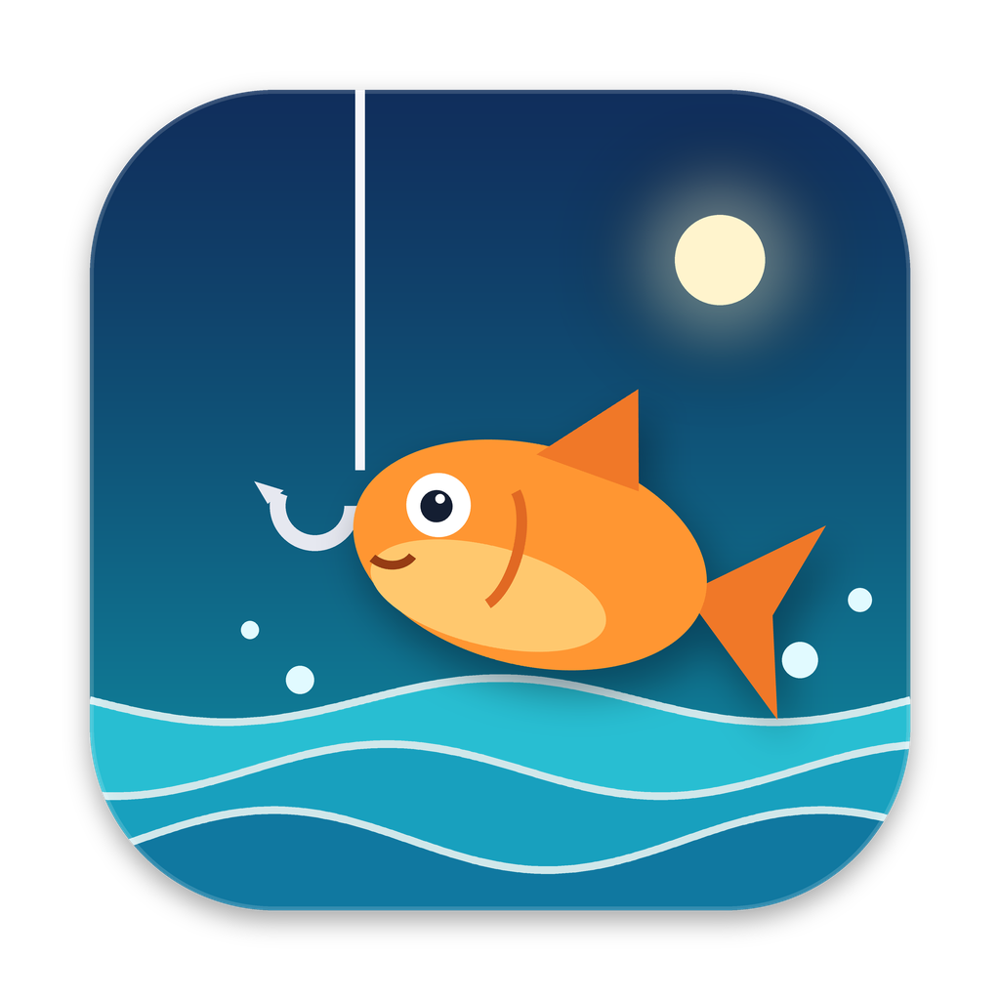

# 🎣 Fischeroo

Plays Fisch for you by reading the screen: casts, clicks the Shake button only when it shows,
and keeps the fish in the bar for perfect catches. It reads your rod, enchants and area by
itself, so there is no setup. Supports Pinion's Aria (falling notes) and Remembrance. It never
reads or changes game memory.

## Download

Get the newest version from **[Releases](../../releases/latest)**:

| Computer | File | How to open |
|---|---|---|
| **Mac** (Apple silicon) | `Fischeroo-Mac.zip` | Unzip and open **Fischeroo** (it moves itself into Applications). |
| **Windows** | `Fischeroo-Windows.exe` | Double-click it. |

The app updates itself: each time it starts it fetches the newest macro, and only installs
updates signed with this project's key. (If an update needs a newer app, the window tells you
to download it again from here.)

### First open on a Mac
The app isn't signed with an Apple developer ID, so macOS blocks the first launch:
1. Open it once; macOS says it can't be checked. Click **Done**.
2. Go to **System Settings → Privacy & Security**, scroll down, and click **Open Anyway** next to "Fischeroo".
3. Allow **Fischeroo** under **Accessibility**, **Screen Recording** and **Input Monitoring**
   (the app's window shows a yellow box with buttons for each), then quit and reopen it.
4. Still blocked with the switches on? Press **Fix permissions** in the yellow box. (Switches
   belong to one exact download of the app; old entries from earlier downloads do nothing.)

### First open on Windows
SmartScreen may say "Windows protected your PC": click **More info → Run anyway**.

## Using it
Equip your rod, stand at the water, press **Start** in the window, and click into Roblox.
Pause with **F6** or by moving the mouse into the top-left corner.
In Fisch's settings, turn off Higher Brightness, Higher Saturation and Wind Shake.

The controls open in their own window; closing it quits the app. Opening the app again while it
runs just brings the window back.

> Macros are against Roblox's and Fisch's rules. Use it at your own risk.
